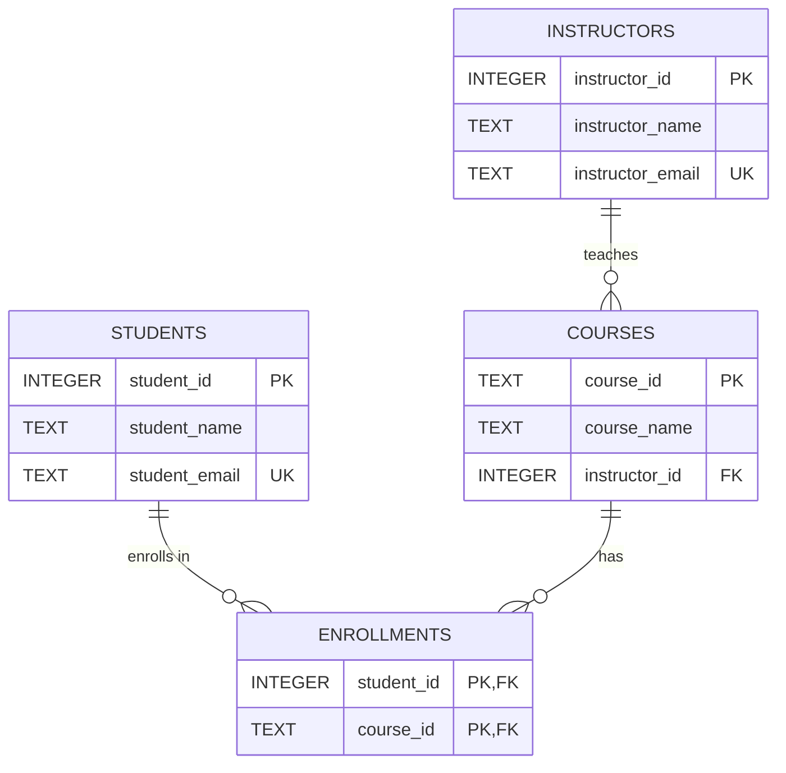
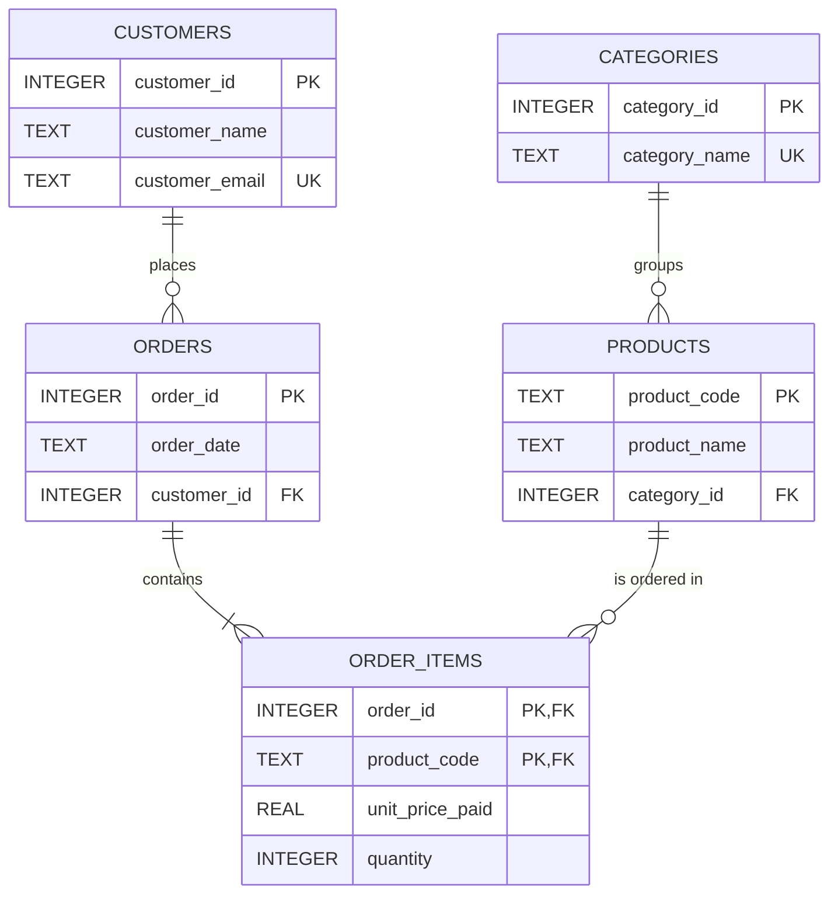
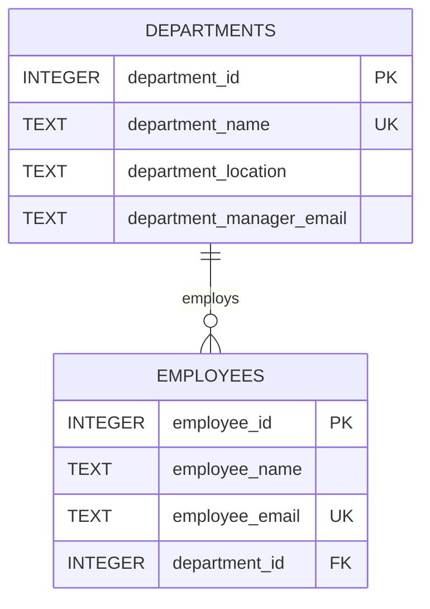
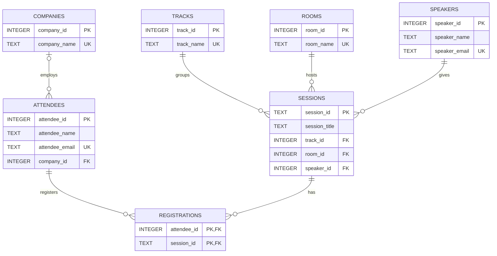

# SQL: Database Design & Normalization

Each task starts from an intentionally denormalized table of `dataset.db`,
finds the dependencies and anomalies in it, and proposes a normalized schema.

Every `.sql` file creates the new tables and fills them from the flat table,
so the redesign can be checked on the real data. The flat tables are kept
untouched for comparison.

## Files

| File | Flat table | New tables |
| --- | --- | --- |
| `0-student_courses.sql` | `student_courses` | `students`, `instructors`, `courses`, `enrollments` |
| `1-order_lines_flat.sql` | `order_lines_flat` | `customers`, `categories`, `products`, `orders`, `order_items` |
| `2-employees_departments.sql` | `employees_departments` | `departments`, `employees` |
| `3-conference_registrations_flat.sql` | `conference_registrations_flat` | `companies`, `tracks`, `rooms`, `speakers`, `attendees`, `sessions`, `registrations` |

## Usage

```
sqlite3 dataset.db < 0-student_courses.sql
```

`dataset.db` can be recreated with `sqlite3 dataset.db < dataset.sql`. Each
file can be run more than once.

## Task 0: student_courses

**Problem.** One row per (student, course) repeats the student, the course and
the instructor.

Dependencies:

- `student_id` -> `student_name`, `student_email`
- `course_id` -> `course_name`, and its instructor
- `instructor_email` -> `instructor_name`

Anomalies found in the data:

- **Update:** Dr. Smith's email is stored in 5 rows, so changing it needs 5
  updates. Missing one leaves two different emails for the same person.
- **Insert:** a course nobody has joined yet, or a student with no course, does
  not fit: every row needs both.
- **Delete:** removing Diego's only enrollment also erases the course C103
  (Algorithms) and Dr. Green.

**Design.** Students, instructors and courses are stored once each.
`enrollments` is a junction table with a composite primary key.
The instructor email changes in one row.



The flat table has no instructor id, so `instructors` gets a surrogate key and
a unique email.

## Task 1: order_lines_flat

**Problem.** Customer, order, product and line data are mixed in one row.

Dependencies:

- `order_id` -> `order_date`, the customer
- `customer_email` -> `customer_name`
- `product_code` -> `product_name`, `category_name`
- (`order_id`, `product_code`) -> `unit_price_paid`, `quantity`

The customer depends on the order, not on the line: this is a partial
dependency (2NF) and a transitive one (3NF).

Anomalies found in the data:

- **Update:** Alice's email is repeated in 3 rows.
- **Insert:** a product that was never ordered, or a customer without orders,
  cannot be stored.
- **Delete:** removing order 1004 also erases Dana Silva.

**Design.** `orders` holds the order-level data, `order_items` the line-level
data, and customers, products and categories are stored once.



**Where `unit_price_paid` goes.** In `order_items`, not in `products`. The
price of a product changes over time, and an old order must still show the
price that was actually paid. If a current price is needed later, it can be
added to `products` as a separate column, without replacing `unit_price_paid`.
`quantity` also belongs to the line, since it depends on the order and the
product together.

`categories` is its own table because the same category name is repeated for
several products and can be renamed in one place.

## Task 2: employees_departments

**Problem.** The key is `employee_id`, so there is no partial dependency, but
the department attributes depend on `department_id`, not on the employee:
`employee_id` -> `department_id` -> `department_name`, `department_location`,
`department_manager_email`. This is a transitive dependency (3NF).

Anomalies found in the data:

- **Update:** moving Engineering to another city changes 3 rows.
- **Insert:** a department without employees cannot exist.
- **Delete:** removing Emma Stone, the only Finance employee, erases the
  Finance department.

**Design.** Department data is stored once and each employee points to it.



The manager is kept as an email on the department, because the manager emails
in the data do not belong to any employee row.

## Task 3: conference_registrations_flat

**Problem.** One row mixes the attendee, the company, the session, its track,
room and speaker, and the registration itself.

Dependencies:

- `attendee_id` -> `attendee_name`, `attendee_email`, `company_name`
- `session_id` -> `session_title`, `track_name`, `room_name`, the speaker
- `speaker_email` -> `speaker_name`
- the registration is the pair (`attendee_id`, `session_id`)

Anomalies found in the data:

- **Update:** Dr. Smith's email is repeated in 5 rows.
- **Insert:** a session nobody registered for, or a speaker without a session,
  cannot be stored.
- **Delete:** removing Carla's only registration erases the session S301
  (Observability 101), its speaker, room and track.

**Design.** Attendee, session and speaker are stored once. `registrations` is
the junction table between attendees and sessions.



**Does `company_name` deserve its own table?** Yes. Strictly, a column with a
single attribute and no dependents is already in 3NF, so this is a design
choice, not a requirement. The reasons for a table:

- one company is shared by several attendees (Blue Rocket, North Dev and Acme IO
  each appear twice), so the name is repeated and can be typed in different
  ways;
- renaming or correcting a company is one update;
- it can grow with its own data (website, country) without touching attendees.

The cost is one extra join. Tracks and rooms follow the same reasoning.
`company_id` allows NULL, because an attendee can come without a company.

## Checks done on the data

For each file, on a copy of `dataset.db`:

- joining the new tables rebuilds the flat table row by row, so no data is lost;
- the row count of each new table equals the distinct entities in the flat table;
- `PRAGMA foreign_key_check` returns nothing, and with foreign keys on, orphan
  rows and duplicate rows are rejected;
- the update, insert and delete anomalies described above no longer happen;
- the file can be run again on an already migrated database.
